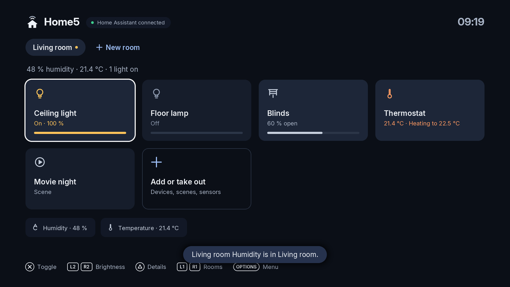
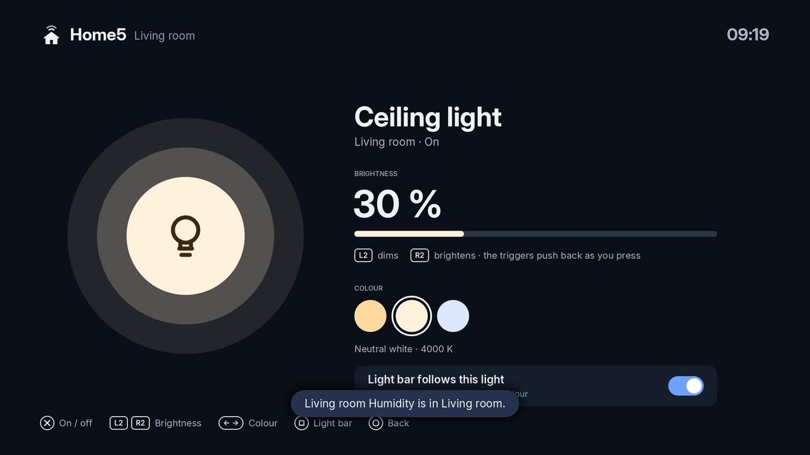
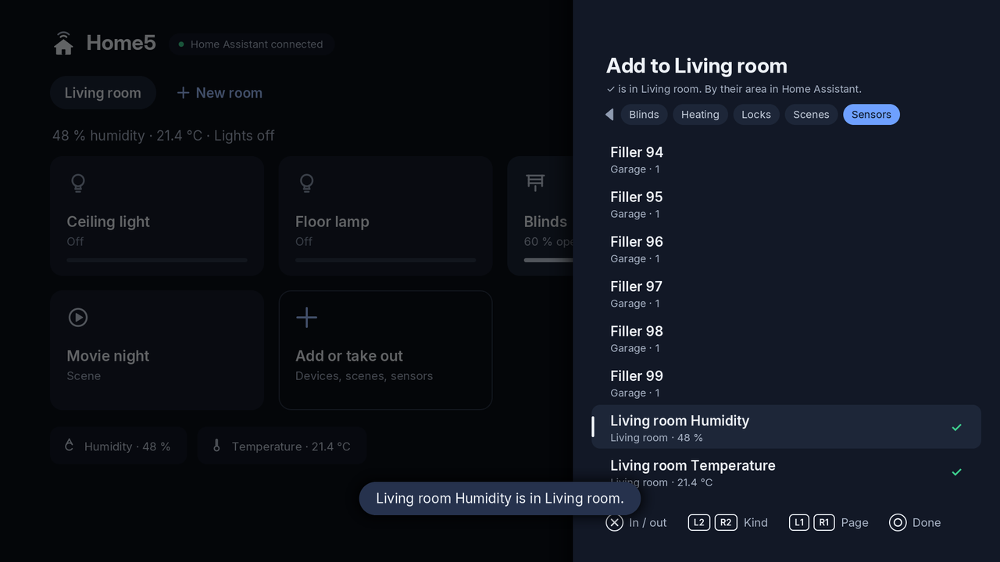
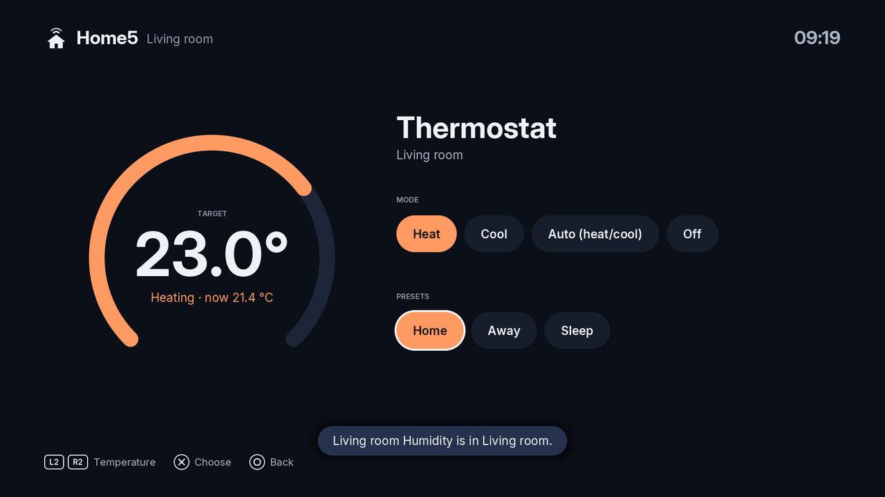

# Home5

<p align="center">
  
</p>

Home Assistant on a PS5 that runs homebrew. You make your rooms on the PS5 and put in them
the lights, switches, blinds, thermostats, scenes and sensors you want; then you switch
lights, set their brightness and colour, open the blinds, set the heating and run scenes,
all with the DualSense: the triggers push back as you dim a light, and the light bar glows
in the colour of the light you are on. The app is `PPSA11019`, its tile is called **Home5**
and it sits under **Media**. This is version 1.0.1.

Home5 is not made by, or connected with, Home Assistant, the Open Home Foundation or Sony.

<p align="right">
  <a href="https://www.buymeacoffee.com/bornaradusin">
    
  </a>
</p>

<p align="center">
  
  
</p>

## Using it

1. Copy the `PPSA11019` folder from `PPSA11019.zip` to the console the way you add any
   homebrew app folder (for example to `/data/homebrew/` for ShadowMountPlus), and start
   **Home5** from Media.
2. Sign in: your Home Assistant's address (`http://192.168.1.20:8123`, with its IP
   address: `homeassistant.local` doesn't work on the PS5), your username and your
   password. The PS5's keyboard opens for each. If you use two-step sign-in, Home5 asks for
   the code next. Home5 keeps a sign-in token on the PS5, never your password.

   Or sign in with a long-lived access token (Home Assistant: your profile › Security):
   put a file `home5.txt` at the top of a USB drive with

   ```text
   address = http://192.168.1.20:8123
   token = eyJhbGciOi…
   ```

   and choose **Or use a token from home5.txt on a USB drive**. Delete the file afterwards.
3. Make your first room: press ✕, name it, and choose what goes in it. The list has
   everything from Home Assistant, by its area there; **L2 / R2** show one kind at a time
   (lights, switches, blinds, heating, locks, media, scenes, sensors), **✕** puts one in or
   takes it out (✓ shows what's in). Nothing is put in a room for you.
4. More rooms come from the **New room** tab after your rooms along the top.

| Buttons | |
| --- | --- |
| ✕ | switch the device on or off, open, run a scene (○ if the console is set to confirm with ○) |
| L2 / R2 | dim and brighten a light, the temperature, a blind's position, a fan's speed |
| △ | a light's or a thermostat's own screen |
| L1 / R1 | the previous or next room |
| Up, to the rooms along the top | left / right picks a room, ✕ opens it |
| □ on a room's tab | deletes the room (asked first) |
| ✕ on a room's last card | add to the room or take out |
| Left / right on a light's screen | its colour |
| □ on a light's screen | whether the light bar follows the light |
| Options | the menu |
| ○ | back |

Locks ask before they lock or unlock. A media player plays or pauses.

<p align="center">
  
  
</p>

## Rooms on this PS5

Your rooms are your own and are kept on the PS5: Home Assistant is never changed by them. A
device can be in more than one room. A room's lights, switches and the rest come first,
then its scenes and scripts, all as cards; its sensors are shown under them.

| Menu (Options) | |
| --- | --- |
| Add to the room or take out | the same list as the room's last card |
| Remove the device from the room | only here on the PS5 |
| Rename the device, rename the room | the name on this PS5 (a device's empty: Home Assistant's again) |
| Move the room left or right | the rooms in your order |
| New room, Delete room | Delete is also □ on the room's tab |
| Light bar follows lights | the controller glows in the colour of the light you are on |
| Remove all rooms | start again with none |
| About Home5, Sign out | signing out revokes Home5's token in Home Assistant |

Home Assistant's notifications show as the console's notifications. Coming from 1.0.0, the
rooms you made there stay, with what you added to them; Home Assistant's areas are no
longer rooms by themselves.

## What it can do

Lights (on/off, brightness, colour), switches and input booleans, fans (speed),
covers (open, close, position), thermostats (temperature, mode, preset), locks, media
players (play/pause), scenes, scripts, buttons, and sensors (shown, with their values).

What it can't do (yet): cameras, alarm panels, vacuums, dashboards, the voice assistant.

The PS5 has to reach Home Assistant directly: on your home network by its IP address, or by
an `https://` address whose certificate a public authority signed (such as a Nabu Casa
address). A self-signed certificate is refused.

If something goes wrong, Home5 writes a log. To get it, put an empty file `home5-log.txt`
at the top of a USB drive and start Home5: it writes its log into that file.

## Building

On Linux (Debian 13 or Ubuntu 24.04) with git, curl, wget, unzip, zip, tar, xz, make,
clang-18, llvm-18 and python3 with Pillow and NumPy:

```bash
bash tests/test.sh   # the host tests: the network, Home Assistant's API (a fake one), the rooms, the screens
bash tools/build.sh  # the app and its packages, into release/
```

`tools/build.sh` builds Home5 on the PS5 Native App Boilerplate and mbedTLS at the versions
in `tools/pins.sh`, every download checked against its SHA-256.

## Licence and credits

Home5 is free software under the GNU General Public License, version 3 or later
([LICENSE](LICENSE)). Some of its files came from PC5 under the LGPL 2.1 or later and keep
that licence. [NOTICE.md](NOTICE.md) has the details.

- [PS5 Native App Boilerplate](https://github.com/mpereiraesaa/ps5-native-app-boilerplate)
  by BlackBearReloaded (GPL-3.0-or-later): the start-up code, the runtime module and the
  signing tools.
- [PS5 payload SDK](https://github.com/ps5-payload-dev/sdk): headers and link stubs.
- [Mbed TLS](https://github.com/Mbed-TLS/mbedtls) (Apache-2.0): HTTPS.
- [Inter](https://github.com/rsms/inter) by Rasmus Andersson (SIL Open Font License 1.1).
- Mozilla's root certificates (MPL-2.0).

Home Assistant is a trademark of the Open Home Foundation. PlayStation, PS5 and DualSense
are trademarks of Sony Interactive Entertainment.
