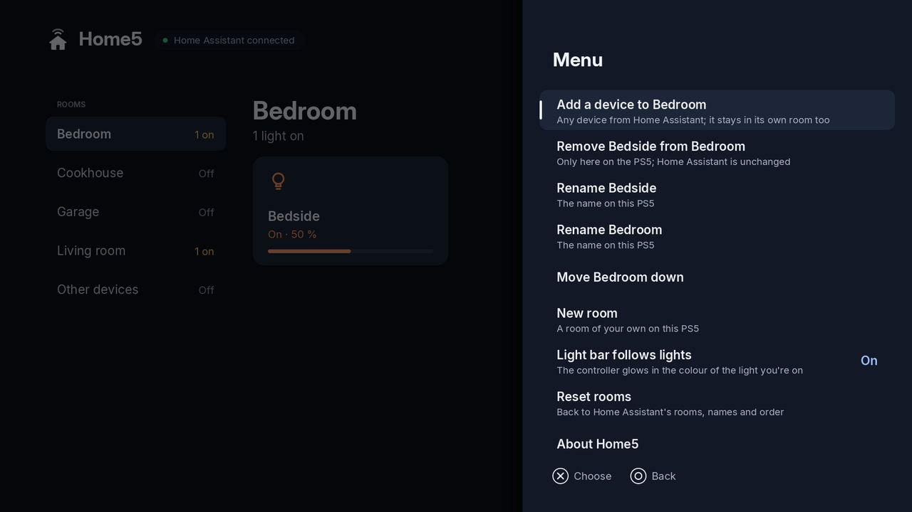

# Home5

<p align="center"></p>

Home Assistant on a PS5 that runs homebrew. Home5 shows your home room by room and lets you
switch lights, set their brightness and colour, open the blinds, set the heating, run scenes
and more, all with the DualSense: the triggers push back as you dim a light, and the light
bar glows in the colour of the light you are on. The app is `PPSA11019`, its tile is called
**Home5** and it sits under **Media**. This is version 1.0.0.

Home5 is not made by, or connected with, Home Assistant, the Open Home Foundation or Sony.

<p align="center">


</p>

## Using it

1. Copy the `PPSA11019` folder from `PPSA11019.zip` to the console the way you add any
   homebrew app folder (for example to `/data/homebrew/` for ShadowMountPlus), and start
   **Home5** from Media.
2. Sign in: your Home Assistant's address (`http://192.168.1.20:8123`, with its IP
   address: `homeassistant.local` doesn't work on the PS5), your username and your
   password. The PS5's keyboard opens for each. If you use two-step sign-in, Home5 asks for
   the code next. Home5 keeps a sign-in token on the PS5, never your password.

   Or sign in with a long-lived access token (Home Assistant: your profile › Security):
   put a file `home5.txt` at the top of a USB drive with

   ```
   address = http://192.168.1.20:8123
   token = eyJhbGciOi…
   ```

   and choose **Or use a token from home5.txt on a USB drive**. Delete the file afterwards.
3. Your rooms are Home Assistant's areas, with the devices Home Assistant has in them.
   Devices in no area are under **Other devices**. A room's scenes and scripts are under
   the list of rooms.

| Buttons | |
| --- | --- |
| ✕ | switch the device on or off, open, run (○ if the console is set to confirm with ○) |
| L2 / R2 | dim and brighten a light, the temperature, a blind's position, a fan's speed |
| △ | a light's or a thermostat's own screen |
| L1 / R1 | the previous or next room |
| Left / right on a light's screen | its colour |
| □ on a light's screen | whether the light bar follows the light |
| Options | the menu |
| ○ | back |

Locks ask before they lock or unlock. A media player plays or pauses.

<p align="center">


</p>

## Rooms on this PS5

Everything you change in the menu is kept on the PS5. Home Assistant is never changed by it.

| Menu | |
| --- | --- |
| Add a device to this room | any device from Home Assistant; it stays in its own room too |
| Remove it from this room | only here on the PS5 |
| Rename the device, rename the room | the name on this PS5 (empty: Home Assistant's again) |
| Move the room up or down | the rooms in your order |
| New room, Delete room | rooms of your own |
| Light bar follows lights | the controller glows in the colour of the light you are on |
| Reset rooms | back to Home Assistant's rooms, names and order |
| About Home5, Sign out | signing out revokes Home5's token in Home Assistant |

When Home Assistant renames an area or moves a device, Home5 shows it at once (your own
changes stay). Home Assistant's notifications show as the console's notifications.

## What it can do

Lights (on/off, brightness, colour), switches and input booleans, fans (speed),
covers (open, close, position), thermostats (temperature, mode, preset), locks, media
players (play/pause), scenes, scripts, buttons, and sensors (shown, with their values).

What it can't do (yet): cameras, alarm panels, vacuums, dashboards, the voice assistant.

The PS5 has to reach Home Assistant directly: on your home network by its IP address, or by
an `https://` address whose certificate a public authority signed (such as a Nabu Casa
address). A self-signed certificate is refused.

If something goes wrong, Home5 writes a log. To get it, put an empty file `home5-log.txt`
at the top of a USB drive and start Home5: it writes its log into that file.

## Building

On Linux (Debian 13 or Ubuntu 24.04) with git, curl, wget, unzip, zip, tar, xz, make,
clang-18, llvm-18 and python3 with Pillow and NumPy:

```
bash tests/test.sh   # the host tests: the network, Home Assistant's API (a fake one), the rooms, the screens
bash tools/build.sh  # the app and its packages, into release/
```

`tools/build.sh` builds Home5 on the PS5 Native App Boilerplate and mbedTLS at the versions
in `tools/pins.sh`, every download checked against its SHA-256.

## Licence and credits

Home5 is free software under the GNU General Public License, version 3 or later
([LICENSE](LICENSE)). Some of its files came from PC5 under the LGPL 2.1 or later and keep
that licence. [NOTICE.md](NOTICE.md) has the details.

- [PS5 Native App Boilerplate](https://github.com/mpereiraesaa/ps5-native-app-boilerplate)
  by BlackBearReloaded (GPL-3.0-or-later): the start-up code, the runtime module and the
  signing tools.
- [PS5 payload SDK](https://github.com/ps5-payload-dev/sdk): headers and link stubs.
- [Mbed TLS](https://github.com/Mbed-TLS/mbedtls) (Apache-2.0): HTTPS.
- [Inter](https://github.com/rsms/inter) by Rasmus Andersson (SIL Open Font License 1.1).
- Mozilla's root certificates (MPL-2.0).

Home Assistant is a trademark of the Open Home Foundation. PlayStation, PS5 and DualSense
are trademarks of Sony Interactive Entertainment.
