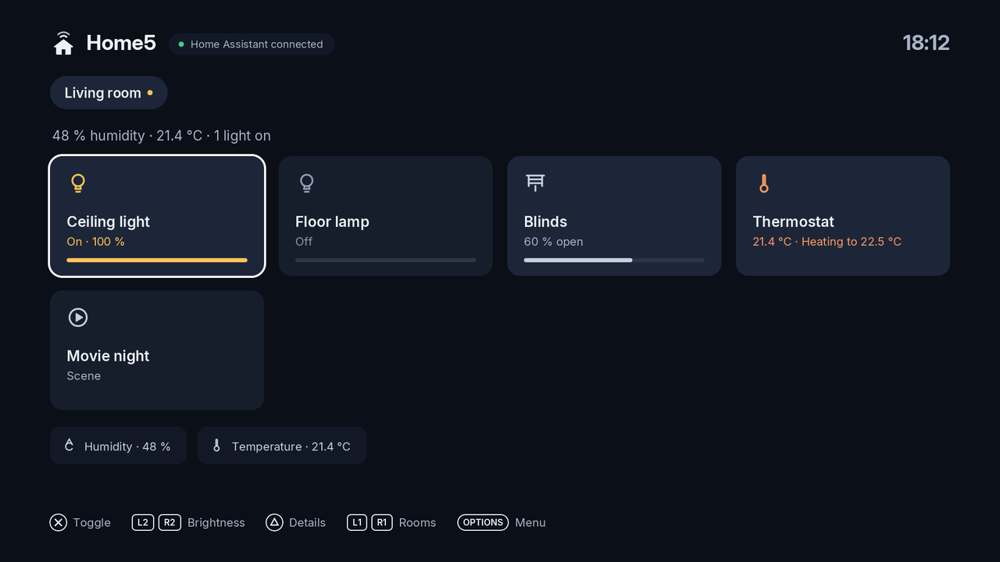

# Home5

Home Assistant on the PS5. Home5 is a homebrew app for a jailbroken console that talks to your own Home Assistant server, so you can see and control your home from the TV — and, with background shortcuts, from inside a game.

Home5 installs under **Media**, not Games.

## Pages

- **[Installing Home5](Installing-Home5)** — download, install, and sign in to Home Assistant.
- **[Rooms, devices and scenes](Rooms-devices-and-scenes)** — set up the home screen the way you want it.
- **[Background shortcuts](Background-shortcuts)** — run Home Assistant actions with a controller combo while a game is running.

## What you need

- A jailbroken PS5 that can run homebrew.
- A Home Assistant server you can reach from the console.
- For background shortcuts: an ELF loader (the one you already use to run payloads).

## Reporting issues

Bugs and ideas go on the [issue tracker](https://github.com/bornaradusin/Home5/issues).
