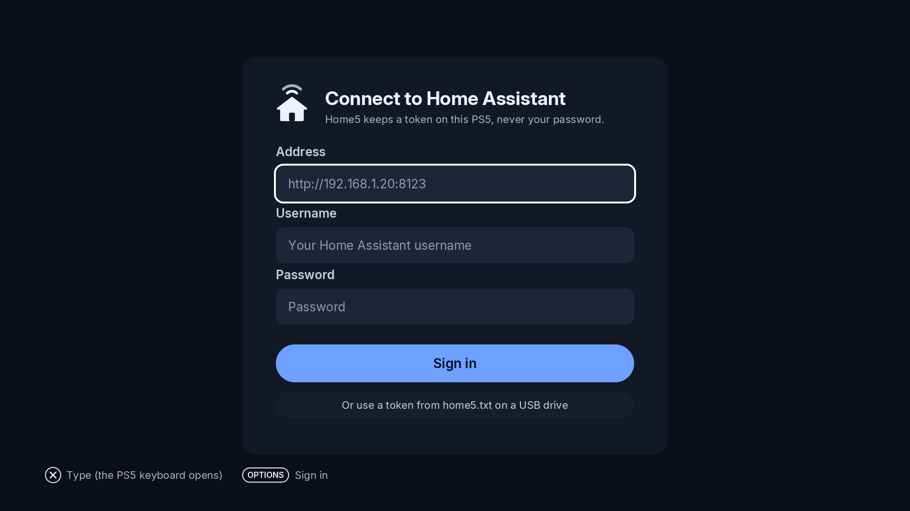

# Installing Home5

## Download

Grab the latest `PPSA11019.zip` from the [releases page](https://github.com/bornaradusin/Home5/releases). Pre-releases marked as test builds are for trying new features and aren't picked up by the updater or ProsperoStore — only install those if you're helping test.

## Install

Install the app the way you install other homebrew on your console. Home5 lands under **Media**, not Games.

## First start — sign in to Home Assistant

On first launch, Home5 asks you to sign in to your Home Assistant server. Enter your server address and authorize the app when Home Assistant prompts you. Home5 keeps the sign-in so you don't have to do it again; you can sign out later from the options.

Nothing is added automatically — Home5 starts empty, and you build the home screen yourself. See **[Rooms, devices and scenes](Rooms-devices-and-scenes)**.

## Updating

Install a newer release over the old one. Your rooms, devices and shortcuts are kept.

## Signing out

Signing out clears the stored Home Assistant sign-in (and the background-shortcuts config that uses it). You'll sign in again next time.
