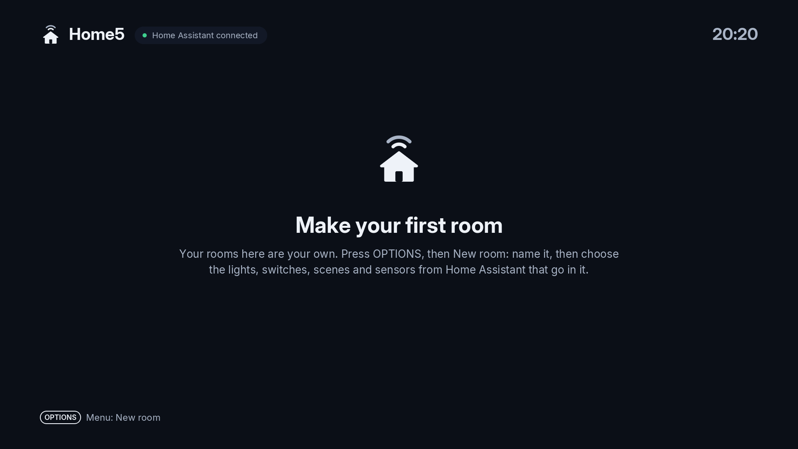
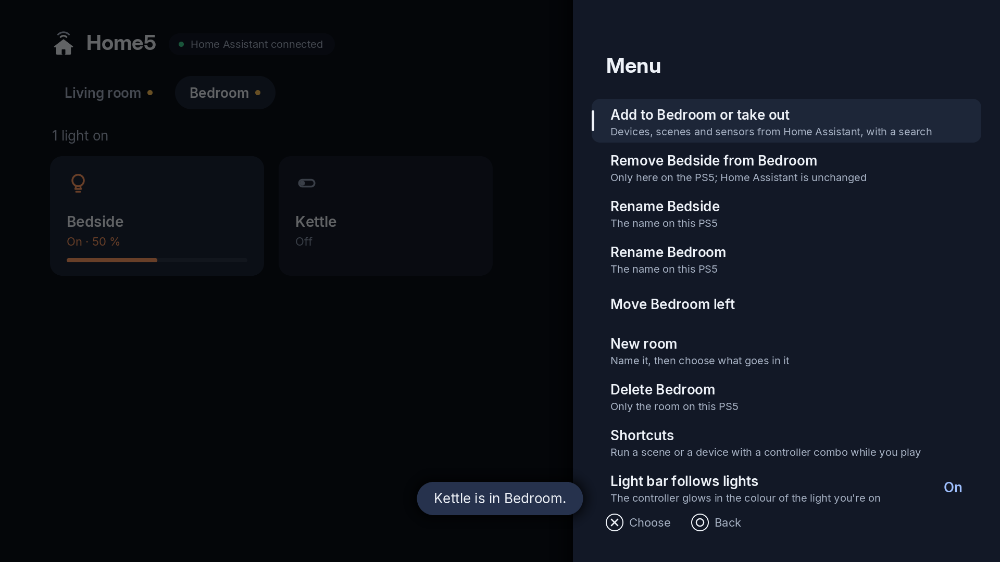
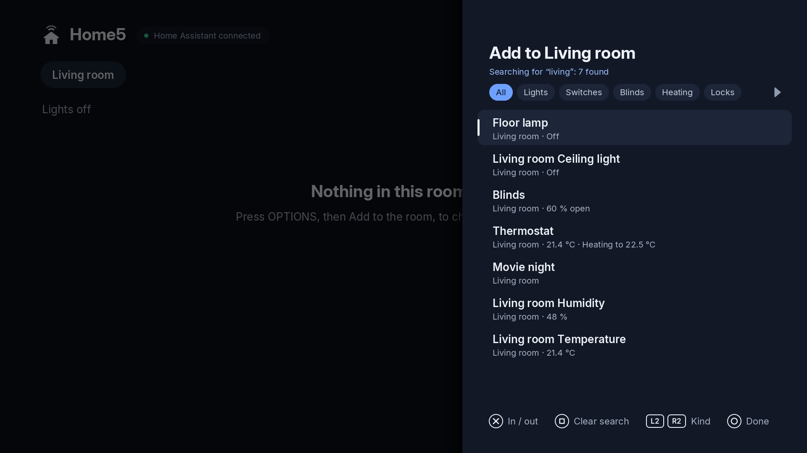
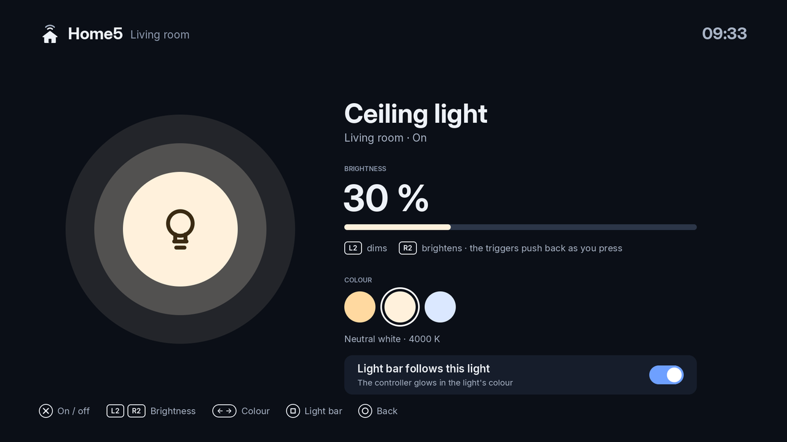

# Rooms, devices and scenes

Home5 starts empty. You decide which rooms exist and what goes in them, so the home screen only shows what you care about.

## Rooms

Rooms run along the top of the screen. You can:

- **Make a room** — from the Options menu.
- **Delete a room** — from the main screen.

The Options menu is where room and device management lives:

Rooms aren't created automatically from Home Assistant; you add the ones you want.

## Adding devices

Add devices to a room from the Options menu. There's a **search** when you're adding, so you can find an entity quickly instead of scrolling the whole list.

Home5 works with the usual kinds:

- Lights
- Switches and fans
- Covers and blinds
- Scenes, scripts and buttons
- Automations
- Sensors

Automations and scenes you add show up as cards you can run from the home screen. Open a light to adjust it — brightness, colour and the rest:

## Scenes

Scenes can be added to rooms like any other entity, so a tap sets the whole room at once.

## Why it's set up this way

Early versions pulled everything in from Home Assistant automatically, which made for a cluttered screen full of entities you'd never touch from the TV. Now you curate it: a few rooms, the devices and scenes you actually use, and nothing else.
